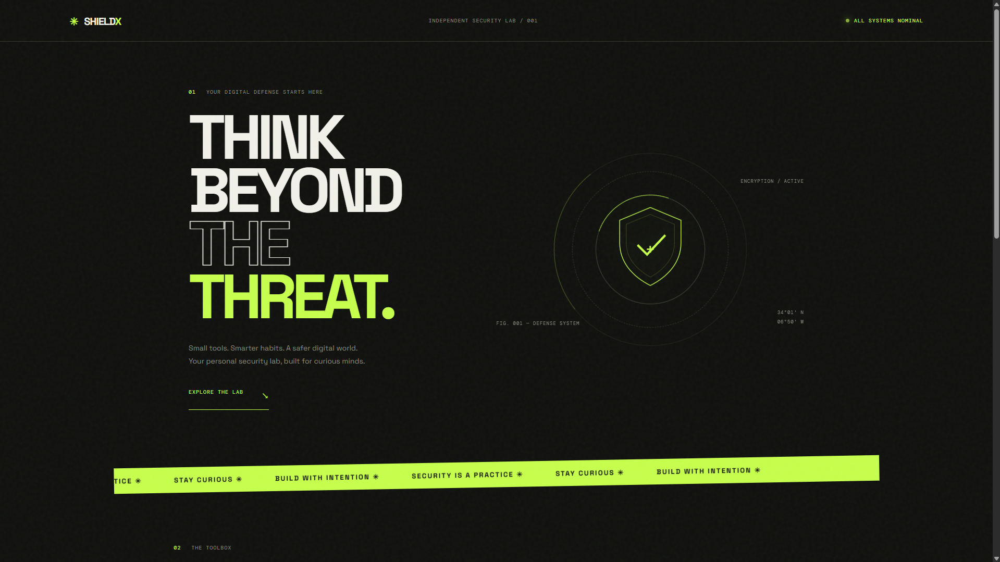
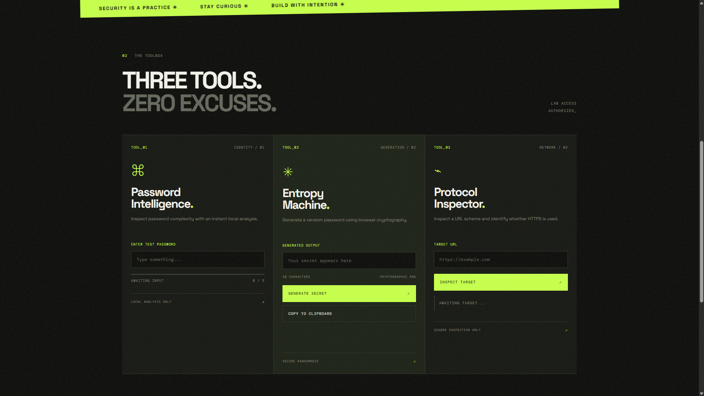

✳ SHIELDX — Security, Reimagined.

<strong>Small tools. Smarter habits. A safer digital world.</strong>
 
A lightweight, interactive cybersecurity toolkit built for curious minds and everyday web users.

## ◈ Overview

SHIELDX is a frontend cybersecurity toolkit designed to make digital security simple, accessible, and understandable.

Built with vanilla HTML, CSS, and JavaScript, it offers practical security tools without frameworks, backends, or unnecessary dependencies.

## ◈ Screenshots

## ◈ Features
Password Intelligence — Analyze password strength through real-time feedback and character diversity checks.
Entropy Machine — Generate secure random passwords using the Web Crypto API.
Protocol Inspector — Check whether a URL uses HTTP or HTTPS.
## ◈ Tech Stack
HTML5
CSS3
Vanilla JavaScript
Web Crypto API
Google Fonts (Space Grotesk & DM Mono)

No frameworks. No build tools. Just pure frontend.

## ◈ Getting Started

Clone the repository:

bash
git clone https://github.com/0dvy/SHIELDX
cd shieldx

Start a local server:

bash
python -m http.server 8000

Open http://localhost:8000 in your browser.

Alternatively, open index.html directly.

## ◈ Project Structure
text
shieldx/
├── assets/
│   ├── preview-1.png
│   └── preview-2.png
├── index.html
├── style.css
├── script.js
├── LICENSE
└── README.md

## ◈ Privacy & Security
Password analysis runs locally in the browser.
Password generation uses the Web Crypto API.
No intentional transmission of passwords to external servers.
URL inspection does not send requests to target websites.

Disclaimer: SHIELDX is an educational toolkit, not a professional security auditing solution. Password analysis uses basic heuristics, and HTTPS detection does not guarantee website safety.

## ◈ Roadmap
Password strength checker
Secure password generator
HTTP/HTTPS inspector
Responsive interface
Password entropy estimation
Security headers analyzer
Automated frontend tests
## ◈ Contributing

Contributions, ideas, and improvements are welcome.

Fork the repository.
Create a feature branch.
Make your changes.
Submit a pull request.
## ◈ License

Released under the MIT License.

<strong>SHIELDX ✳</strong>
 
<em>Think beyond the threat.</em>
  
If you like this project, consider giving it a ⭐.

